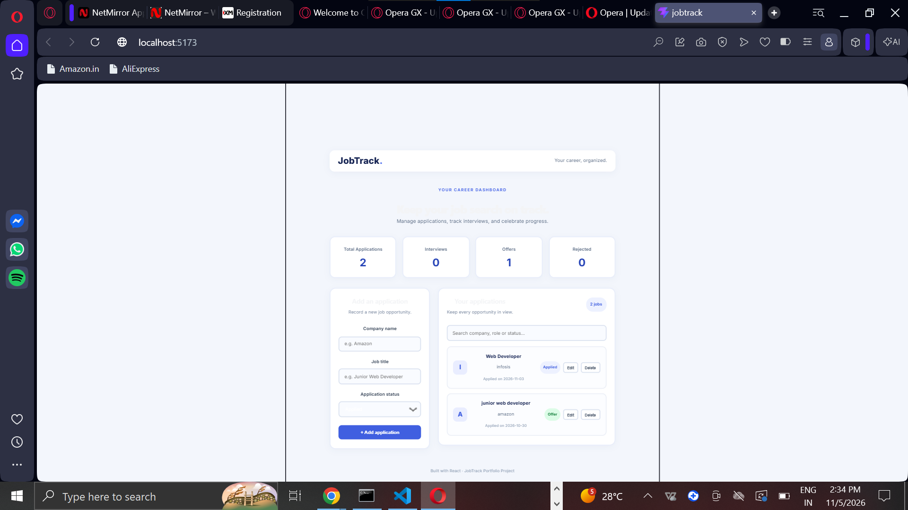

# JobTrack – Job Application Tracker

A simple and user-friendly job application tracking web application built using React, Node.js, Express.js, and MongoDB.

## Features

- Add new job applications
- Edit existing applications
- Delete job applications
- Track application status
- Search and filter applications
- Dashboard with application statistics
- Store job application data in MongoDB

## Technologies Used

- **Frontend:** React.js, JavaScript, CSS
- **Backend:** Node.js, Express.js
- **Database:** MongoDB
- **Tools:** VS Code, Git, GitHub

## Project Structure

```text
JobTrack/
├── src/
│   ├── App.jsx
│   └── App.css
├── server/
│   └── server.js
├── public/
├── package.json
└── README.md
```

## Installation and Setup

1. Clone the repository:

```bash
git clone https://github.com/aayushityagi-ui/Job-Track.git
```

2. Open the project folder:

```bash
cd Job-Track
```

3. Install frontend dependencies:

```bash
npm install
```

4. Configure the backend environment variables in `server/.env`:

```env
MONGO_URI=your_mongodb_connection_string
PORT=5000
```

5. Install backend dependencies:

```bash
cd server
npm install
```

6. Start the backend:

```bash
node server.js
```

7. Open another terminal in the project folder and start the frontend:

```bash
npm run dev
```

## Future Improvements

- User authentication
- Application reminders
- More dashboard analytics

## Author
Aayushi Tyagi
## Dashboard Preview



